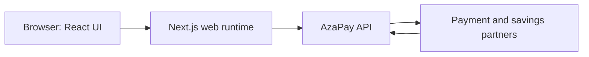
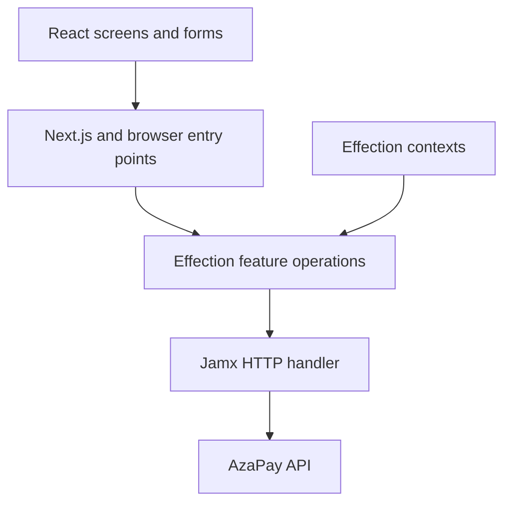

# AzaPay frontend architecture

Status: working design, 2026-09-24.

This document describes the intended customer web application. It records the
boundaries and invariants that should guide implementation; it is not a claim
that the current repository implements them.

## Sources and responsibilities

1. The [AzaPay OpenAPI contract](https://azapay.onrender.com/openapi.json) defines
   supported operations, request and response shapes, and backend-owned state.
2. The frontend owns presentation and user interaction. The AzaPay backend owns
   money movement, balances, fees, schedules, readiness, and settlement status.
3. The [architecture decision records](decisions/README.md) capture the chosen
   application structure and the rationale for consequential changes.

The contract inspected for this first version was AzaPay API `0.4.0` (79 paths,
100 operations). Recheck the live contract before implementing each module.
For operations the frontend uses, maintain Zod request and response schemas
aligned with that contract and infer their TypeScript types from the schemas.
The OpenAPI document remains authoritative; see
[ADR 0006](decisions/0006-zod-api-contract.md).

## System boundaries

The browser renders the experience and starts actions. The web runtime is the
session and API boundary; see [ADR 0004](decisions/0004-nextjs-bff.md).
The AzaPay API remains authoritative. Partner webhooks and settlement processing
belong to that backend, outside this frontend application.

## Application structure

The initial runtime contracts live in
[`apps/web/src/application`](../../apps/web/src/application). Their boundaries
and usage are documented in [Foundation](foundation.md). The first customer
feature uses them for account access.

Effection is the backbone of application logic, not an optional request helper.
Each feature module exposes explicit TypeScript contracts and Effection
operations. Operations compose use cases and own their child work. Effection
contexts provide implementations for capabilities such as the AzaPay API,
session, clock, and logger. A scope belongs to one server request or one
browser workflow; mutable per-user context must never be shared globally.

Effection contexts carry Jamx's HTTP handler and logger directly. Jamx already
provides the abstractions needed for transport composition and logging; the
frontend does not introduce a second HTTP or logger port. Each feature
operation supplies its scope's abort signal to Jamx and converts the returned
transport result into a typed application outcome. See
[ADR 0008](decisions/0008-direct-jamx-capabilities.md).

At the API contract boundary, Zod `safeParse` validates outgoing payloads and
incoming external data. A validation failure becomes a typed `Left`, including
an unexpected-response category when the backend response no longer matches the
contract. Schemas cover the operations a module actually uses and preserve the
API's money strings; they do not create new product rules. Keep detailed
validation issues in redacted diagnostics rather than customer-facing errors.

fp-ts `Either` is the error contract. Application operations return
`Operation<Either<AppError, Value>>`: Effection owns asynchronous lifetime and
composition, while `Left` and `Right` represent failure and success. Application
code does not deliberately throw. Feature operations catch exceptions and rejected
promises from external libraries at their boundary, normalize them to typed `Left` values, and
preserve Effection halting as cancellation rather than a business error. Next.js
server actions may reject at their configuration or authentication boundary; see
[ADR 0005](decisions/0005-fp-ts-errors.md) and
[ADR 0009](decisions/0009-server-action-boundary-throws.md).

Suggested module boundaries are `account`, `dashboard`, `funding`, `flow`,
`aza`, `activity`, and `settings`. The read-only dashboard combines
backend-owned overview, Flow, category, and audit responses for presentation.
Flow domain reads and writes live in the separate `flow` feature module;
dashboard operations only load data for the account summary. The Flow module
owns Flow categories, payment and savings instructions, and their API-backed
run previews and history. Each module owns its operations, contract-facing types,
mapping from API responses, and tests.
The `aza` module owns Aza lifecycle, invitations, contribution instructions, and
withdrawal quotes and status. Next.js pages and actions adapt customer input to
those operations; the API remains authoritative for balances, closure rules,
withdrawal charges, maturity, and settlement.
The `settings` module also owns API-backed consent state, consent acceptance,
and account deactivation. Deactivation clears the local session only after the
API confirms the request and revokes all sessions.
Shared code should be limited to cross-cutting capabilities such as money
formatting, dates, session, and transport.

## Rules that apply to every feature

- Show customer-facing naira amounts while preserving the API's two-decimal
  kobo-string representation at the transport boundary. Avoid floating-point
  calculations for money.
- Render backend-provided balances, fees, readiness, and transaction outcomes.
  A successful request to create an instruction does not mean money has settled.
- Do not automatically replay a money-moving write. Use the API's required
  idempotency keys where specified and re-read backend state after an uncertain
  result. Halting an Effection operation does not reverse a write accepted by
  the backend.
- Expected failures and caught external faults travel as typed `Left` values.
  Screens must handle both sides of an `Either`; no error should be converted
  into a false success or silently discarded.
- Use Zod `safeParse` at the API boundary. An invalid response must not be
  treated as a successful result, and a schema must not coerce a money string
  into a floating-point number.
- Follow the documented resource lifecycle: categories are archived, Azas are
  closed under backend rules, and direct Aza-to-Aza transfers are refused.
- Do not infer balances, fees, login methods, or money movement paths from UI
  state or hard-coded assumptions. Use documented API behaviour.

## Documentation and records

Architecture decisions live in [`decisions/`](decisions/README.md). An ADR
records context, decision, consequences, status, and the evidence that may
prompt review. Update the overview when a module boundary or runtime path
changes. Add or supersede an ADR when a consequential choice changes; preserve
the old record rather than rewriting its history.

Before writing Next.js code, read the relevant installed
`node_modules/next/dist/docs/` guides as required by the repository's
`AGENTS.md`.
